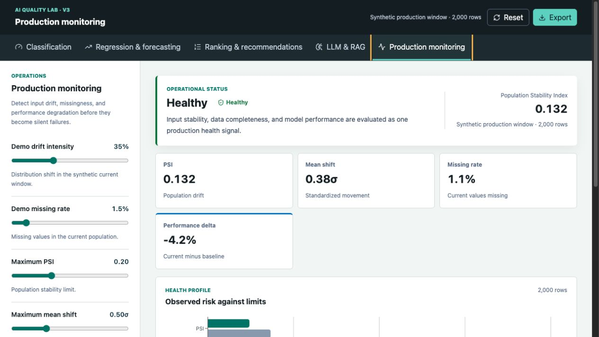

# AI/ML Project Atlas and Quality Lab

This site is an interactive portfolio for Ayush Soni's public AI, machine-learning, GenAI, analytics, and production-system work. Its Project Atlas maps all 19 repositories into visual, themed project stories; the embedded AI Quality Lab remains a browser-based decision-support suite for evaluating whether an AI or ML system is ready to launch and healthy in production.

**Live product:** [ayush210895.github.io/ai-quality-lab](https://ayush210895.github.io/ai-quality-lab/)

## Project Atlas experience

- Searchable, category-based explorer for all public projects.
- Dedicated hash URL for every project, suitable for direct sharing.
- Project-specific color system and live visual preview.
- A prominent, evidence-bounded decision statement for every project.
- Story, architecture, and evidence views with verified metrics and honest limitations.
- Visible Projects and Quality Lab navigation, direct repository links, and related-project paths.
- A persistent route into the interactive Quality Lab.

Example project URL:

```text
https://ayush210895.github.io/ai-quality-lab/#/projects/travel-marketplace-harm-risk
```

## Quality Lab



## Evaluation workspaces

- **Evidence registry:** maps all 19 public GitHub repositories to their model family, evidence state, pinned source commit, repository, and matching evaluation path.
- **Classification:** confusion matrix, PR-AUC, threshold optimization, false-positive and false-negative economics, and review capacity.
- **Regression and forecasting:** MAE, RMSE, WAPE, directional bias, R², and prediction-interval coverage.
- **Ranking and recommendations:** Precision@K, Recall@K, NDCG@K, MRR, and catalog coverage.
- **LLM and RAG:** answer quality, groundedness, retrieval quality, citation coverage, safety, latency, and cost.
- **Production monitoring:** Population Stability Index, standardized mean shift, missingness, and performance degradation.
- **GitHub model comparison:** traceable baseline-versus-candidate evidence from the public Travel Marketplace Harm-Risk model, pinned to its source commit and final-test artifacts.

Every workspace includes a reproducible synthetic scenario, adjustable production gates, local CSV evaluation, a visual system profile, and a downloadable JSON evidence report.

## Portfolio evidence states

The project portfolio deliberately separates repository visibility from evaluation readiness:

- **Connected:** a repository-specific adapter renders traceable committed evidence in the Quality Lab.
- **Evidence ready:** a committed report exists and can be normalized into an adapter next.
- **Needs artifact:** model or metric code exists, but a reproducible evaluation output still needs to be committed.
- **Learning / Infrastructure:** useful portfolio work that should be tracked without being scored as a production model.

The registry is a pinned static snapshot, so the public application does not depend on GitHub API availability or expose account credentials.

## Classification threshold optimization

The threshold optimizer evaluates every distinct model score and recommends the lowest-cost operating point that reaches at least 70% recall without exceeding the selected review capacity. The interface compares the current, recommended, and all-negative policies before a reviewer applies a change.

## Evaluate your own model

Choose **Upload CSV** and select a file with these required columns:

```csv
actual,score
0,0.08
1,0.91
```

- `actual` must be `0` or `1`.
- `score` must be between `0` and `1`.
- Both outcome classes must be present.
- Extra columns are allowed and ignored.
- Files are limited to 15 MB and 200,000 rows.

The file is parsed and evaluated locally in the browser. It is not uploaded to a server.

Other workspaces expose their required CSV columns directly beside the upload control and provide a downloadable sample file. Uploaded files remain browser-local across all modules.

## Run locally

From this directory:

```bash
pnpm install
pnpm dev
```

Vite prints the local URL when the development server starts.

## Product stack

- React and TypeScript for isolated, reliable workspace state.
- Vite for development and production builds.
- Tailwind CSS for the responsive operational interface.
- Recharts for accessible model-quality visualizations.
- Zod for validating downloaded evidence reports.
- Browser-local CSV parsing; no evaluation data is sent to a backend.

## Test

```bash
pnpm test
pnpm build
```

Requires Node.js 20.19 or newer.

Every push and pull request runs syntax checks and unit tests through GitHub Actions. A separate workflow deploys the static application to GitHub Pages after changes reach `main`.

## Next product increments

1. Add segment-level reliability and fairness slices across model families.
2. Add bootstrap uncertainty intervals and baseline-versus-candidate comparison.
3. Export a human-readable launch decision memo.

## Scope boundary

This is a standalone evaluation product. The LLM and RAG workspace uses generic evaluation schemas and synthetic examples; it does not read from, write to, import, or modify the existing RAG project.

