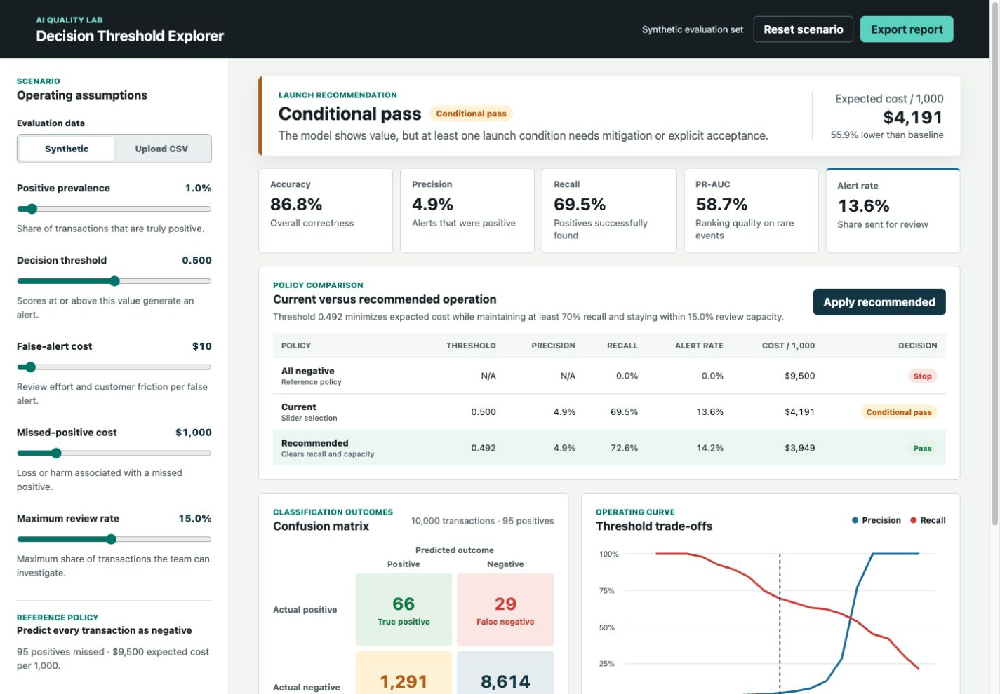

# AI Quality Lab

AI Quality Lab is a decision-support product for evaluating whether an ML system is ready to launch. The first module, **Decision Threshold Explorer**, connects model scores to operating capacity and business cost.



## Current module

The explorer generates a reproducible imbalanced-classification scenario and lets a reviewer change:

- positive-class prevalence;
- decision threshold;
- false-positive and false-negative costs;
- maximum review capacity.

It calculates the confusion matrix, accuracy, precision, recall, F1, PR-AUC, alert volume, expected cost, and cost improvement over an all-negative baseline. Transparent quality, economics, and capacity gates produce a `Pass`, `Conditional pass`, or `Stop` recommendation.

## Run locally

From this directory:

```bash
python3 -m http.server 8765 --directory dist
```

Then open `http://localhost:8765`.

## Test

```bash
node --test tests/metrics.test.mjs
```

Requires a current Node.js release with the built-in test runner.

## Next product increments

1. Upload and validate real prediction files.
2. Recommend the lowest-cost threshold that satisfies quality and capacity constraints.
3. Compare current, recommended, and baseline operating policies.
4. Add uncertainty and segment-level reliability checks.
5. Export a human-readable launch decision memo.

## Scope boundary

This is a standalone evaluation product. It does not read from, write to, import, or modify the existing RAG project.

